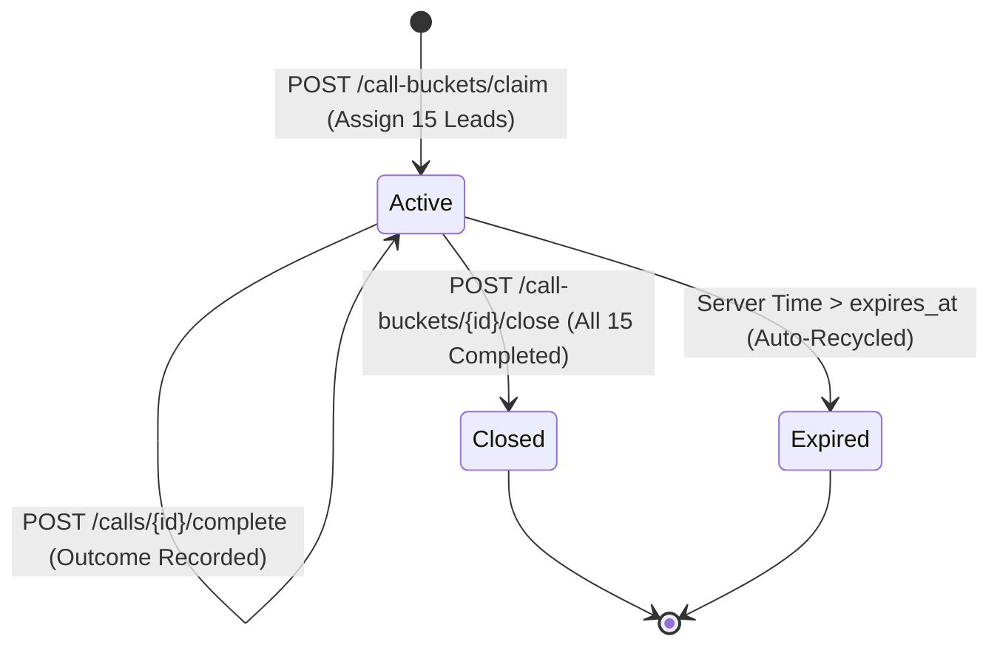
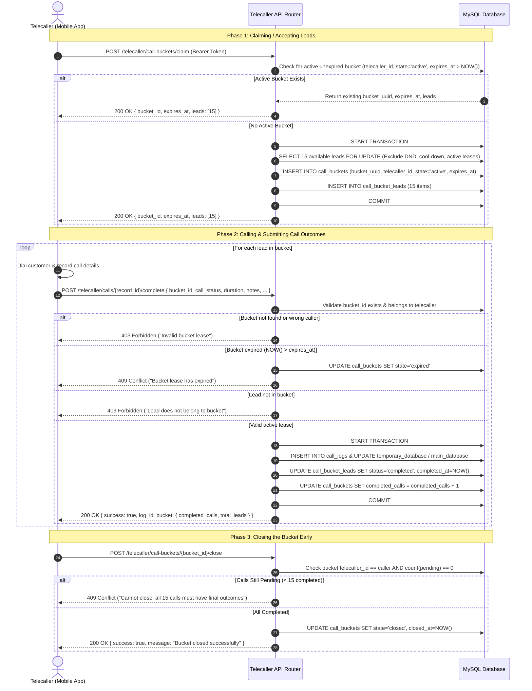

# Call Bucket Leases & Calling Queue Distribution Design Specification

## Overview

In CallNow CRM, mobile telecallers require server-authoritative lease protection for customer contact distribution. Without server-enforced leases, production calling assignments risk double-dialing the same customer across multiple callers, stale local state on mobile devices, and uncoordinated dialing queues.

This specification details the architecture, lifecycle, database schema, transactional locking mechanisms, and API contracts for call bucket leases.

---

## Core Philosophy

1. **Server-Authoritative Validation**: The mobile device must never decide if a bucket or lead is valid. The server validates bucket ownership, expiration, and lead membership on every request.
2. **Strict Transactional Safety**: Leases are claimed and numbers assigned atomically within an ACID transaction using row-level locking (`FOR UPDATE`). No customer number can ever be issued to two callers simultaneously.
3. **15-Minute Expiry Window**: An active bucket has a 15-minute lease duration from the time of assignment (`assigned_at + 15 minutes`).
4. **Resumable & Idempotent**: A telecaller requesting a bucket while having an active unexpired bucket receives their existing bucket and leads rather than creating duplicate leases.
5. **Early Close Validation**: A bucket can be closed early only by its assigned telecaller, and only when all assigned calls have final outcomes.

---

## State Lifecycle & Data Flow



### Complete End-to-End Sequence



---

## Database Architecture

Two normalized tables partition bucket metadata and lead items:

### 1. `call_buckets`
Tracks lease headers, lifetime, ownership, and state:

| Column | Type | Nullable | Description |
|---|---|---|---|
| `id` | `INT AUTO_INCREMENT` | No | Primary Key |
| `bucket_uuid` | `VARCHAR(64)` | No | Public UUID v4 sent to the mobile client |
| `company_code` | `VARCHAR(50)` | No | Multi-tenant tenant/company code (`callnow_incredit` / `incredit`) |
| `telecaller_id` | `INT` | No | User ID (`users.ID`) assigned to the bucket |
| `state` | `ENUM('active','closed','expired')` | No | Current lifecycle state (default `'active'`) |
| `assigned_at` | `DATETIME` | No | Lease grant timestamp (default `CURRENT_TIMESTAMP`) |
| `expires_at` | `DATETIME` | No | Expiration timestamp (`assigned_at + 15 MINUTE`) |
| `closed_at` | `DATETIME` | Yes | Early closure timestamp |
| `total_leads` | `INT` | No | Total leads assigned (default 15) |
| `completed_calls`| `INT` | No | Count of finalized call outcomes |
| `created_at` | `DATETIME` | No | Row creation timestamp |
| `updated_at` | `DATETIME` | No | Row update timestamp |

**Indexes**:
- `PRIMARY KEY (id)`
- `UNIQUE KEY uniq_bucket_uuid (bucket_uuid)`
- `KEY idx_telecaller_state (telecaller_id, state, expires_at)`
- `KEY idx_expires (expires_at, state)`

### 2. `call_bucket_leads`
Tracks individual lead assignments and outcomes:

| Column | Type | Nullable | Description |
|---|---|---|---|
| `id` | `INT AUTO_INCREMENT` | No | Primary Key |
| `bucket_id` | `INT` | No | Foreign Key to `call_buckets.id` |
| `bucket_uuid` | `VARCHAR(64)` | No | Redundant denormalized UUID for direct query joins |
| `source` | `ENUM('TEMP','MAIN')` | No | Origin table (`temporary_database` or `main_database`) |
| `lead_id` | `INT` | No | Record ID in the underlying source table |
| `status` | `ENUM('pending','completed')` | No | Item outcome status (default `'pending'`) |
| `call_log_id` | `INT` | Yes | Foreign Key referencing resulting `call_logs.id` |
| `completed_at` | `DATETIME` | Yes | Timestamp when the outcome was submitted |
| `created_at` | `DATETIME` | No | Row creation timestamp |

**Indexes**:
- `PRIMARY KEY (id)`
- `KEY idx_bucket (bucket_id)`
- `KEY idx_bucket_lead (bucket_uuid, source, lead_id)`
- `KEY idx_lead_source (source, lead_id, status)`
- `KEY idx_status (status)`

---

## API Specifications

### 1. Claim or Resume Bucket Lease
* **Endpoint**: `POST /telecaller/call-buckets/claim` (and `/api/v1/telecaller/call-buckets/claim`)
* **Headers**:
  * `Authorization: Bearer <telecaller-token>`
  * `Content-Type: application/json`
* **Response: 200 OK**:
```json
{
  "success": true,
  "data": {
    "bucket_id": "c4b3f81e-627a-4ecb-99f4-180a52df03d1",
    "expires_at": "2026-11-18T10:35:00Z",
    "leads": [
      {
        "id": 1052,
        "record_id": 1052,
        "source": "TEMP",
        "name": "Rajesh Kumar",
        "mobile": "9876543210",
        "formatted_mobile": "+91 98765 43210",
        "dial_phone": "+919876543210",
        "dial_uri": "tel:+919876543210",
        "company": "ABC Corp",
        "package": "Gold",
        "other_info": "Interested in loan",
        "last_status": "Not Called",
        "call_status": "pending"
      }
    ]
  }
}
```

### 2. Submit Call Outcome with Lease Enforcement
* **Endpoint**: `POST /telecaller/calls/{id}/complete` (and `/api/v1/telecaller/calls/{id}/complete`)
* **Headers**:
  * `Authorization: Bearer <telecaller-token>`
  * `Content-Type: application/json`
* **Request Payload**:
```json
{
  "bucket_id": "c4b3f81e-627a-4ecb-99f4-180a52df03d1",
  "source": "TEMP",
  "call_status": "Connected",
  "call_duration": 45,
  "notes": "Spoke with client, requested callback on Friday",
  "next_followup": "2026-11-20 14:00:00",
  "client_call_id": "78a9c8d1-4412-40f9-a411-cf9b02bc4512"
}
```
* **Validation & Error Codes**:
  * `400 Bad Request`: `bucket_id` missing from payload.
  * `403 Forbidden`: `bucket_id` does not belong to caller, or `lead_id` does not belong to this bucket.
  * `409 Conflict`: Bucket lease has expired, bucket is already closed, or lead was reassigned to another caller.
* **Response: 200 OK**:
```json
{
  "success": true,
  "data": {
    "message": "Call result submitted successfully",
    "log_id": 3491,
    "record_id": 1052,
    "source": "TEMP",
    "bucket": {
      "bucket_id": "c4b3f81e-627a-4ecb-99f4-180a52df03d1",
      "completed_calls": 1,
      "total_leads": 15,
      "all_completed": false
    },
    "engagement": {
      "xp_earned": 50,
      "total_xp": 1250,
      "level": 2,
      "level_title": "Silver Caller 🥈"
    }
  }
}
```

### 3. Early Close Bucket
* **Endpoint**: `POST /telecaller/call-buckets/{bucket_id}/close` (and `/api/v1/telecaller/call-buckets/{bucket_id}/close`)
* **Headers**:
  * `Authorization: Bearer <telecaller-token>`
  * `Content-Type: application/json`
* **Validation & Error Codes**:
  * `403 Forbidden`: Authenticated user is not the owner of the bucket.
  * `404 Not Found`: Bucket does not exist.
  * `409 Conflict`: Bucket already closed, or pending calls exist (`pending_count > 0`).
* **Response: 200 OK**:
```json
{
  "success": true,
  "message": "Bucket closed successfully",
  "data": {
    "bucket_id": "c4b3f81e-627a-4ecb-99f4-180a52df03d1",
    "closed_at": "2026-11-18 10:28:15",
    "completed_calls": 15,
    "total_leads": 15
  }
}
```

---

## Production SQL Execution Script

The following SQL queries must be executed on the production MySQL database:

```sql
-- 1. Create call_buckets table
CREATE TABLE IF NOT EXISTS call_buckets (
    id INT AUTO_INCREMENT PRIMARY KEY,
    bucket_uuid VARCHAR(64) NOT NULL,
    company_code VARCHAR(50) NOT NULL DEFAULT 'default',
    telecaller_id INT NOT NULL,
    state ENUM('active', 'closed', 'expired') NOT NULL DEFAULT 'active',
    assigned_at DATETIME NOT NULL DEFAULT CURRENT_TIMESTAMP,
    expires_at DATETIME NOT NULL,
    closed_at DATETIME NULL DEFAULT NULL,
    total_leads INT NOT NULL DEFAULT 15,
    completed_calls INT NOT NULL DEFAULT 0,
    created_at DATETIME NOT NULL DEFAULT CURRENT_TIMESTAMP,
    updated_at DATETIME NOT NULL DEFAULT CURRENT_TIMESTAMP ON UPDATE CURRENT_TIMESTAMP,
    UNIQUE KEY uniq_bucket_uuid (bucket_uuid),
    KEY idx_telecaller_state (telecaller_id, state, expires_at),
    KEY idx_expires (expires_at, state)
) ENGINE=InnoDB DEFAULT CHARSET=utf8mb4 COLLATE=utf8mb4_general_ci;

-- 2. Create call_bucket_leads table
CREATE TABLE IF NOT EXISTS call_bucket_leads (
    id INT AUTO_INCREMENT PRIMARY KEY,
    bucket_id INT NOT NULL,
    bucket_uuid VARCHAR(64) NOT NULL,
    source ENUM('TEMP', 'MAIN') NOT NULL DEFAULT 'TEMP',
    lead_id INT NOT NULL,
    status ENUM('pending', 'completed') NOT NULL DEFAULT 'pending',
    call_log_id INT NULL DEFAULT NULL,
    completed_at DATETIME NULL DEFAULT NULL,
    created_at DATETIME NOT NULL DEFAULT CURRENT_TIMESTAMP,
    KEY idx_bucket (bucket_id),
    KEY idx_bucket_uuid (bucket_uuid),
    KEY idx_bucket_lead (bucket_uuid, source, lead_id),
    KEY idx_lead_source (source, lead_id, status),
    KEY idx_status (status)
) ENGINE=InnoDB DEFAULT CHARSET=utf8mb4 COLLATE=utf8mb4_general_ci;
```
