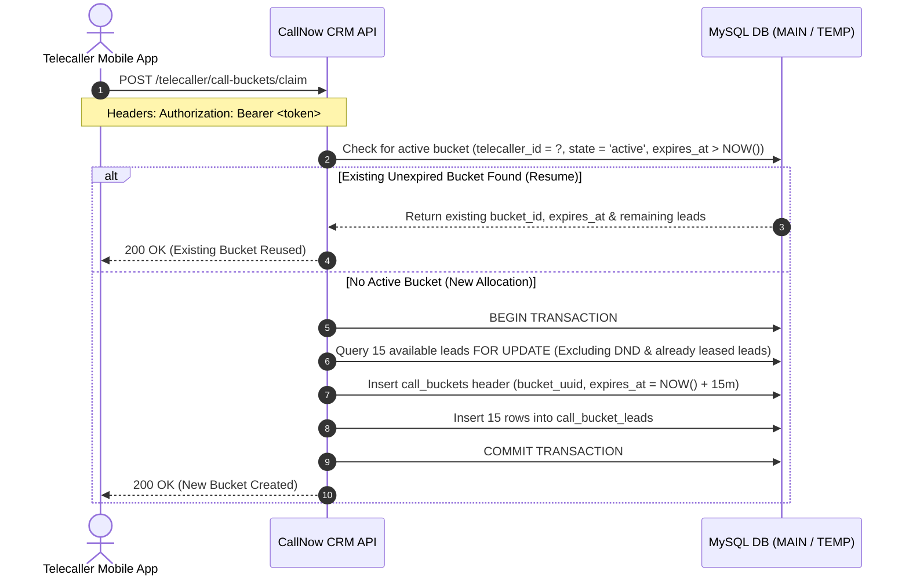
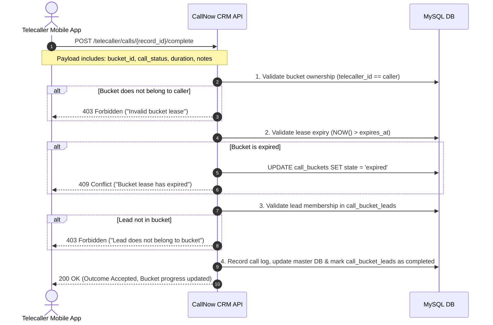

# Mobile App & Server Call Bucket Leases: Contact Number Sending & Accepting Flow

This guide explains how contact numbers are sent, leased, dialed, accepted, and closed between the **CallNow CRM Server** and the **Mobile Application**.

---

## 1. High-Level Concept: Server-Authoritative Bucket Leases

To prevent multiple telecallers from dialing the same customer simultaneously, contact numbers are **never sent individually or without server lease locks**.

Instead, numbers are grouped into **Call Buckets of 15 Leads** with a **15-minute lease duration**.
* **The server decides validity**: The phone app does not determine whether a queue is still valid—the server enforces expiration, ownership, and assignment state on every API request.
* **Double-calling is physically impossible**: The assignment query locks candidates with `SELECT ... FOR UPDATE` inside an ACID transaction and excludes any numbers leased to another caller.
* **App restarts & reconnection safe**: If a telecaller loses internet, closes the app, or reconnects within their 15-minute lease window, the server returns their existing unexpired bucket.

---

## 2. Step-by-Step Flow: Sending & Accepting Numbers

### Phase 1: Requesting & Receiving Contact Numbers (Claim)



#### API Request:
`POST /telecaller/call-buckets/claim` *(or `/api/v1/telecaller/call-buckets/claim`)*
* **Headers**: `Authorization: Bearer <token>`
* **Body**: `{}`

#### API Response:
```json
{
  "success": true,
  "data": {
    "bucket_id": "9b1deb4d-3b7d-4bad-9bdd-2b0d7b3dcb6d",
    "expires_at": "2026-11-18T10:45:00Z",
    "leads": [
      {
        "id": 1052,
        "record_id": 1052,
        "source": "TEMP",
        "name": "Sunil Verma",
        "mobile": "9812345678",
        "formatted_mobile": "+91 98123 45678",
        "dial_phone": "+919812345678",
        "dial_uri": "tel:+919812345678",
        "company": "FastTech Pvt Ltd",
        "package": "Standard",
        "other_info": "Callback requested",
        "last_status": "Not Called",
        "call_status": "pending"
      }
    ]
  }
}
```

---

### Phase 2: Dialing and Accepting Call Outcomes (Complete)

After the telecaller dials each customer from the bucket list, the mobile app submits the call outcome to the server.



#### API Request:
`POST /telecaller/calls/1052/complete` *(or `/api/v1/telecaller/calls/1052/complete`)*
```json
{
  "bucket_id": "9b1deb4d-3b7d-4bad-9bdd-2b0d7b3dcb6d",
  "source": "TEMP",
  "call_status": "Connected",
  "call_duration": 48,
  "notes": "Discussed loan requirements. Customer interested in personal loan.",
  "client_call_id": "c1f73b62-11e2-45e0-b620-d31e9c2b4d9a"
}
```

#### Success Response (200 OK):
```json
{
  "success": true,
  "data": {
    "message": "Call result submitted successfully",
    "log_id": 4821,
    "record_id": 1052,
    "source": "TEMP",
    "bucket": {
      "bucket_id": "9b1deb4d-3b7d-4bad-9bdd-2b0d7b3dcb6d",
      "completed_calls": 1,
      "total_leads": 15,
      "all_completed": false
    },
    "engagement": {
      "xp_earned": 50,
      "total_xp": 1500,
      "level": 2,
      "level_title": "Silver Caller 🥈"
    }
  }
}
```

#### Error Responses Enforcing Server Lease Rules:
* **HTTP 400 Bad Request**: If `bucket_id` is missing in request.
* **HTTP 403 Forbidden**: If the bucket belongs to another caller or lead is not in the bucket.
* **HTTP 409 Conflict**:
  * *"Call bucket lease has expired. Please claim a new bucket."*
  * *"Lead has been reassigned to another caller."*

---

### Phase 3: Closing an Early-Finished Bucket

When the telecaller completes all 15 calls before the 15-minute lease expires, they can immediately close the bucket to claim a fresh batch:

#### API Request:
`POST /telecaller/call-buckets/9b1deb4d-3b7d-4bad-9bdd-2b0d7b3dcb6d/close`

#### Server Validation:
1. Validates that the caller is the owner (`telecaller_id === $currentUserId`).
2. Validates that **all 15 calls** have final outcomes (`pending_count === 0`).
   * If any calls are still uncalled/pending, the server rejects with **HTTP 409 Conflict**:
     `{"success":false,"error":{"code":409,"message":"Cannot close bucket: all 15 calls must have final outcomes. 2 calls pending."}}`
3. On success, transitions `call_buckets.state = 'closed'`, sets `closed_at = NOW()`.
4. Telecaller can immediately call `POST /telecaller/call-buckets/claim` to receive the next 15 fresh leads.

---

### Phase 4: Lease Expiry & Automatic Recycling

If a telecaller goes offline, closes the app, or takes longer than 15 minutes:
1. **Server-Side Expiry**: The server rejects any further call completions on that bucket with **HTTP 409 Conflict**.
2. **Automatic Number Recycling**: Any leads in that expired bucket that were **not** dialed/completed automatically become available for other active telecallers when they claim their next bucket.
3. **No Double-Calling**: Because assignment queries check `NOT EXISTS (SELECT 1 FROM call_bucket_leads ... WHERE cb.state = 'active' AND cb.expires_at > NOW())`, numbers in active leases are shielded from other telecallers, and expired uncalled numbers are seamlessly recovered.

---

## 3. Server Database Queries to Execute

Execute these two SQL statements on the production database (`callnow_incredit` / tenant database):

```sql
-- 1. Table to store bucket lease headers and state
CREATE TABLE IF NOT EXISTS call_buckets (
    id INT AUTO_INCREMENT PRIMARY KEY,
    bucket_uuid VARCHAR(64) NOT NULL,
    company_code VARCHAR(50) NOT NULL DEFAULT 'default',
    telecaller_id INT NOT NULL,
    state ENUM('active', 'closed', 'expired') NOT NULL DEFAULT 'active',
    assigned_at DATETIME NOT NULL DEFAULT CURRENT_TIMESTAMP,
    expires_at DATETIME NOT NULL,
    closed_at DATETIME NULL DEFAULT NULL,
    total_leads INT NOT NULL DEFAULT 15,
    completed_calls INT NOT NULL DEFAULT 0,
    created_at DATETIME NOT NULL DEFAULT CURRENT_TIMESTAMP,
    updated_at DATETIME NOT NULL DEFAULT CURRENT_TIMESTAMP ON UPDATE CURRENT_TIMESTAMP,
    UNIQUE KEY uniq_bucket_uuid (bucket_uuid),
    KEY idx_telecaller_state (telecaller_id, state, expires_at),
    KEY idx_expires (expires_at, state)
) ENGINE=InnoDB DEFAULT CHARSET=utf8mb4 COLLATE=utf8mb4_general_ci;

-- 2. Table to store individual lead items in each bucket
CREATE TABLE IF NOT EXISTS call_bucket_leads (
    id INT AUTO_INCREMENT PRIMARY KEY,
    bucket_id INT NOT NULL,
    bucket_uuid VARCHAR(64) NOT NULL,
    source ENUM('TEMP', 'MAIN') NOT NULL DEFAULT 'TEMP',
    lead_id INT NOT NULL,
    status ENUM('pending', 'completed') NOT NULL DEFAULT 'pending',
    call_log_id INT NULL DEFAULT NULL,
    completed_at DATETIME NULL DEFAULT NULL,
    created_at DATETIME NOT NULL DEFAULT CURRENT_TIMESTAMP,
    KEY idx_bucket (bucket_id),
    KEY idx_bucket_uuid (bucket_uuid),
    KEY idx_bucket_lead (bucket_uuid, source, lead_id),
    KEY idx_lead_source (source, lead_id, status),
    KEY idx_status (status)
) ENGINE=InnoDB DEFAULT CHARSET=utf8mb4 COLLATE=utf8mb4_general_ci;
```
