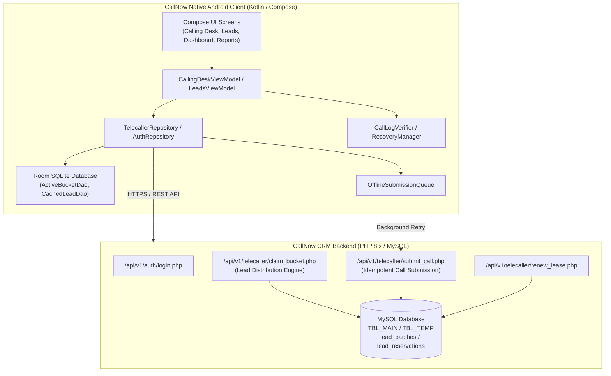
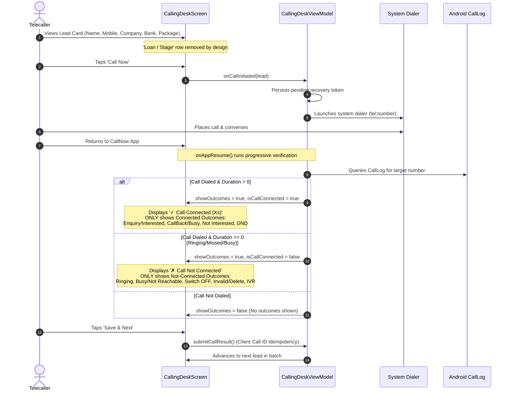

# CallNow Project Handoff Document
**Date:** November 19, 2026  
**System:** CallNow CRM & CallNow Native Android App  
**Target Audience:** Incoming Full-Stack / Mobile Engineers, Tech Leads, QA  

---

## 1. Executive Summary

**CallNow** is an enterprise telecalling CRM suite consisting of:
1. **PHP/MySQL Backend & Web CRM** (`c:\xampp\htdocs\callnowCRM`) — Procedural PHP 8.x backend with RESTful API endpoints (`/api/v1/telecaller/`), batch allocation engine, lead management, and administrative dashboards.
2. **Native Android Client** (`e:\Projects\KotlinProjects\callnow-android-native-starter`) — Modern, 100% Kotlin Jetpack Compose application built with clean architecture (MVVM, Room, Retrofit, Coroutines/Flow) replacing the legacy Flutter codebase (`com.example.callnow_new`).

The solution is specifically engineered for high-velocity outbound financial calling desks (loans, mortgages, insurance) where call tracking integrity, zero duplicate allocations across telecallers, and call-log-verified outcome recording are mandatory.

---

## 2. System Architecture



---

## 3. Repositories & Tech Stacks

### 3.1 Backend & Web CRM
- **Path:** `c:\xampp\htdocs\callnowCRM`
- **Tech Stack:** PHP 8.x procedural, MySQL (`mysqli`), Bootstrap 5.3, jQuery, DataTables.
- **Entry Points:**
  - Web CRM: `http://localhost/callnowCRM/` (protected via `php_scripts/auth.php`)
  - Telecaller API: `http://localhost/callnowCRM/api/v1/telecaller/`
  - Auth API: `http://localhost/callnowCRM/api/v1/auth/`
- **Core Database Tables:**
  - `tbl_main_database` (`TBL_MAIN`) — Primary bank/loan leads.
  - `tbl_temp_database` (`TBL_TEMP`) — Raw imported calling database.
  - `tbl_call_logs` (`TBL_CALL_LOGS`) — Complete telecaller call attempts and verified outcomes.
  - `lead_batches` & `lead_reservations` — Lease concurrency and distribution tracking.

### 3.2 Native Android Client
- **Path:** `e:\Projects\KotlinProjects\callnow-android-native-starter`
- **Application ID:** `com.example.callnow_new` (Debug suffix: `.debug`)
- **Tech Stack:**
  - **Language:** Kotlin 2.0+ (JVM target 17, minSdk 26, compileSdk/targetSdk 37).
  - **UI Toolkit:** Jetpack Compose + Material 3.
  - **State Management:** MVVM with Kotlin Coroutines `StateFlow` and structured lifecycle collectors.
  - **Networking:** Retrofit 2 + OkHttp 4 + KotlinX Serialization.
  - **Local Storage:** Room Database (`CallNowDatabase`) for offline caching of active lead batches and submissions.
  - **Device Telephony:** Android `CallLog` provider query engine with fuzzy last-10-digit number matching (`CallLogMatcher`).

---

## 4. Key Workflows & Business Logic

### 4.1 Calling Desk Lifecycle & Outcome Recording
The Calling Desk is the primary operational interface for telecallers. Its behavior is strictly defined:



#### Outcome Decision Rules:
1. **Loan / Stage Row:** Completely removed from the lead contact card.
2. **Outcome Visibility Gate:** Outcomes **never** display prior to dialing. They are revealed either automatically upon returning from the dialer (if a dialed call is confirmed in `CallLog`) or when explicitly tapping **"Get Status"**.
3. **Category Lock:**
   - **Connected (`durationSeconds > 0`):** Only Connected options (*Enquiry/ Intrested*, *CallBack/ Busy*, *Not Intrested*, *DND*) are visible. Manual tab switching is disabled.
   - **Not Connected (`durationSeconds == 0`):** Only Not-Connected options (*Ringing*, *Busy / Not Rechable*, *Switch OFF*, *Invalid/Delete*, *IVR / Voicemail*) are visible.
4. **Target Integrity:** Daily target counters (`dailyTarget`, `callsToday`) remain strictly preserved without alteration.

### 4.2 Lead Distribution & Concurrency Engine (Leases)
To eliminate duplicate call assignments across telecallers:
1. **Batch Claiming (`claim_bucket.php`):** Telecallers claim buckets of 15 contacts at a time. The query uses `FOR UPDATE` row-level locks, skipping locked records.
2. **Lease Duration:** Each bucket is granted with a lease time (1200 seconds / 20 minutes).
3. **Heartbeat Maintenance (`renew_lease.php`):** The Android app executes a background heartbeat every 10 minutes (`heartbeatIntervalSeconds = 600`) to renew the lease.
4. **Lease Expiry & Reclamation:** If an app is killed or abandoned without releasing, the server's sweeper releases uncalled leads back to the available pool once the lease expires.

### 4.3 Offline Queue & Idempotency
- **Client Call ID:** Every call initiated generates a UUID `client_call_id`.
- **Offline Enqueueing:** If a telecaller submits an outcome with no cellular data, the outcome is stored in `OfflineSubmissionQueue` (Room table).
- **Safe Replay:** When connectivity resumes, submissions replay with their original `client_call_id` and timestamps, preventing duplicate calls in CRM logs.

---

## 5. API Reference & Contracts

All endpoints accept and return JSON. Authenticated requests require Bearer token authorization:
`Authorization: Bearer <token>` or `X-Company-Code: <slug>`.

| Endpoint | Method | Purpose |
|---|---|---|
| `/api/v1/auth/login.php` | `POST` | Authenticates telecaller with username/password, returns user profile & token |
| `/api/v1/telecaller/claim_bucket.php` | `POST` | Claims a new batch of 15 leads with atomic row locking |
| `/api/v1/telecaller/renew_lease.php` | `POST` | Heartbeat endpoint extending active bucket lease |
| `/api/v1/telecaller/release_bucket.php` | `POST` | Releases remaining uncalled leads when telecaller finishes or logs out |
| `/api/v1/telecaller/submit_call.php` | `POST` | Records verified call outcome, note, followup, and updates master database |
| `/api/v1/telecaller/engagement_stats.php` | `GET` | Fetches telecaller's calls completed today, target today, and rank |
| `/api/v1/telecaller/leads.php` | `GET` | Paginated lead browsing and search across pipeline stages |

---

## 6. Development & Testing Guide

### 6.1 Prerequisites
- **Android Studio Ladybug (or newer)** with Android SDK 35/37.
- **Java Development Kit (JDK):** Version 17 or 21.
- **XAMPP / PHP 8.x & MySQL:** Running on port 80/3306.
- **Physical Android Test Device:** Connected via USB with Developer Mode & USB Debugging enabled.

### 6.2 Running Automated Tests
From the root of the Android repository (`e:\Projects\KotlinProjects\callnow-android-native-starter`):
```powershell
# Run all unit tests
.\gradlew testDebugUnitTest

# Run Calling Desk ViewModel tests specifically
.\gradlew testDebugUnitTest --tests "com.incraax.callnow.ui.callingdesk.CallingDeskViewModelTest"
```

### 6.3 Building and Installing to Connected Device
```powershell
# Verify device connection
adb devices

# Build and install debug APK
.\gradlew installDebug

# Launch the application
adb shell am start -n com.example.callnow_new.debug/com.incraax.callnow.MainActivity
```

### 6.4 Connecting Device to Local Backend
1. If testing against local XAMPP Apache, ensure the device is on the same local Wi-Fi network.
2. In the app login / server settings screen, enter the host machine's Wi-Fi IP (e.g. `http://192.168.1.50/callnowCRM`).
3. For Android emulators, use `http://10.0.2.2/callnowCRM`.

---

## 7. Known Nuances & Engineering Gotchas

1. **Android CallLog Permissions:** Android restricts `READ_CALL_LOG`. The app explicitly prompts for runtime permission. In Android 14/15, if the user grants "While using the app", call logs must be checked promptly upon returning from the dialer.
2. **Dialer Timing Skew:** When returning from external dialers, some OEM ROMs (MIUI, ColorOS) delay writing to the system call log by 500ms–1500ms. The `onAppResume()` progressive poller retries with exponential backoff (`[1200ms, 1300ms, 1500ms, 2000ms]`) to reliably capture durations.
3. **Dual Table Architecture:** The CRM stores raw cold uploads in `tbl_temp_database` and qualified/converted leads in `tbl_main_database`. The mobile API handles both transparently via `source: 'MAIN' | 'TEMP'`.
4. **Duplicate Declarations in Compose:** When sharing constants (such as outcome lists) across screens and ViewModels, define them at the package level inside `CallingDeskUiState.kt` rather than repeating private definitions across Composable files.

---

## 8. Immediate Next Steps / Recommendations

1. **Production Pipeline:** Configure GitHub Actions / GitLab CI for automated linting (`./gradlew lintDebug`) and test execution.
2. **App Bundles (`.aab`):** Set up release signing keys in `key.properties` for production Google Play / internal distribution deployment.
3. **Telemetry & Crashlytics:** Add Firebase Crashlytics to monitor background sync retry exceptions and call log matcher misses in production.
